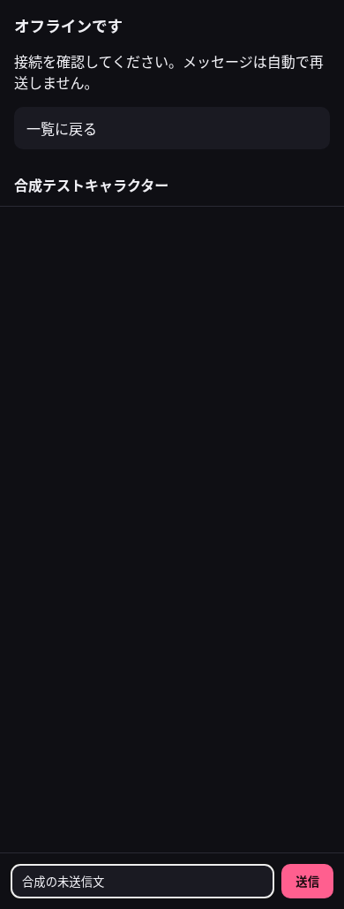
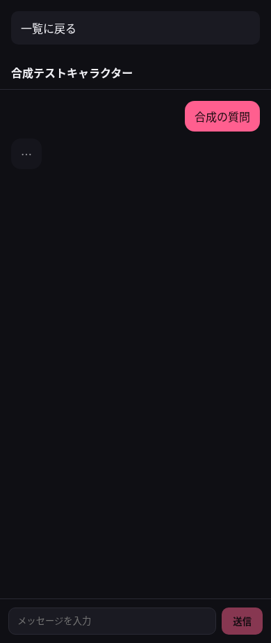

# RIT-85: 失敗・待機・圏外からの復帰

一覧や会話の読み込みに失敗した場合と、生成を待っている場合に、一覧へ戻るか読み込みを再試行できる。root の描画例外と不明 URL にも同じ復帰先を用意する。

Linear: RIT-85 / 親 RIT-55。PR #28 の会話再開経路を保持した上に、状態 component と route adapter を接続した。メッセージ component・CSS・認証・生成 API・共有依存・lockfile に、この差分からの変更はない。画像生成への影響は対象外で、画像 API も変更していない。

## 証跡の範囲

画面は source commit `97a1b883b3a43c99684031b3bec677eeda7117cf` で撮影した。記録用の commit は画面の source を変えない。Chromium の viewport は 390×844。実際の一覧・会話・root の状態 slot を使用し、データ取得だけを一般合成 fixture に置き換えた。localhost 以外へのリクエストは拒否し、実 API・本番 DB・秘密・実会話を使っていない。

[browser-report.json](browser-report.json) に全結果を記録した。23表示で押せない出口は0、意図した合成 POST は6、圏外表示・復帰による自動 POST は0、外部通信・予期しないエラー・横はみ出しは0。保存済み pending の会話を root 再試行後に復元する場合は、既存の再接続 POST が発生する。その場合も同じ `requestId` / `conversationId` が維持されることを別の route 結合試験で確認した。

## 状態一覧 N=23

| 番号 | 状態                    | 押して確かめた出口                           |
| ---- | ----------------------- | -------------------------------------------- |
| 1    | 会話の読込待機          | 一覧へ戻る。遅い応答でも会話へ戻されない     |
| 2    | 会話の読込失敗          | 再試行成功、連続失敗後にも戻る               |
| 3    | 利用不能キャラクター    | キーボードで一覧へ戻る                       |
| 4    | 会話の読込待機中に圏外  | 圏外のまま戻る                               |
| 5    | 会話の読込失敗中に圏外  | 再試行、戻る                                 |
| 6    | 表示済み会話で圏外      | 入力保持、復帰後も自動送信なし、戻る         |
| 7    | 生成 HTTP 応答待機      | 戻る                                         |
| 8    | 生成 stream の途中      | 戻る                                         |
| 9    | 生成失敗                | HTTP・SSE・空応答の各失敗から戻る            |
| 10   | 生成の途中 EOF          | 接続失敗の表示から戻る                       |
| 11   | 一覧の読込待機          | 再試行                                       |
| 12   | 一覧の読込失敗          | 再試行                                       |
| 13   | 一覧0件                 | 再試行                                       |
| 14   | 一覧の読込待機中に圏外  | 再試行、接続復帰                             |
| 15   | 一覧の読込失敗中に圏外  | 連続失敗、再試行、復帰                       |
| 16   | 表示済み一覧で圏外      | 項目を保持、再試行、復帰                     |
| 17   | 一覧0件かつ圏外         | 操作が重複しないこと、再試行、復帰           |
| 18   | root の読込待機         | 再試行                                       |
| 19   | root の読込失敗         | 再試行                                       |
| 20   | root の読込待機中に圏外 | 再試行、復帰                                 |
| 21   | root の読込失敗中に圏外 | 再試行、復帰                                 |
| 22   | 不明 URL                | 実際の一覧 component へ戻る                  |
| 23   | root の描画例外         | 原因を修正した後の reset・再試行で一覧へ復帰 |

## 代表画面

| 待機                        | 読込失敗                  | 圏外の会話                         |
| --------------------------- | ------------------------- | ---------------------------------- |
|  |  |  |

| 生成待機                            | 一覧待機                      | 一覧0件かつ圏外                             | root 描画例外                         |
| ----------------------------------- | ----------------------------- | ------------------------------------------- | ------------------------------------- |
|  |  |  |  |

## 独立レビューで回収した失敗シナリオ

- 戻り先の一覧自体が失敗する: 実一覧 loader を使う再試行と、不明 URL → 一覧失敗 → 再試行成功の結合試験を追加。
- 圏外かつ0件で同名操作が二重になる: 状態を統合し、再試行ボタンが1個であることを試験。
- 古い GET が残る: router の abort signal を各 serverFn に渡し、待機中の再試行・離脱で前の signal が中断されることを試験。
- 会話再開時に別の内容へ状態が混ざる: 移行経路の `key` と `initialConversationId` を維持。
- root 再試行で新規送信が作られる: 保存済み pending を使う実 ChatView の結合試験で、同じ受付番号の再接続であることを確認。
- loader の失敗だけを試験して描画例外を見逃す: production root slot による実際の描画例外と reset 復帰を試験。

## ローカル検証の再現

```sh
pnpm --filter @v2/app run test src/component/app-route-state.test.tsx src/component/chat-route-state.test.tsx src/component/list-route-state.test.tsx --maxWorkers=1
pnpm --filter @v2/app run lint
pnpm --filter @v2/app run typecheck
pnpm --filter @v2/app run build
node apps/v2/script/verify-state-exit.mjs
task ci:fast
pnpm run v2:ci
```

状態の結合試験は27件成功。`task ci:fast` は3993件成功・22件 skip、coverage 閾値も成功。`pnpm run v2:ci` は app 145件、db 32件、engine 19件、judge 332件、bench 44件、prompt 21件、cf 6件が成功した。workerd 実行検査も、認証境界、切断中の完了、同一 replay、409 conflict、保存2件、cursor replay、10回の連続再接続を確認した。

D1 を使う検査は専用の空ディレクトリを `.wrangler/state` へプロセス内で bind し、既存の DB を再利用しない。空の D1 への全 migration のログで既存検査スクリプトの1MiB上限を超える失敗も再現したため、その受取上限だけを16MiBへ広げ、別の空 D1 から成功を確認した。実キャラ fixture の読取許可は既存 CI のローカル検査に限定し、その本文をこの証跡へ転載していない。

バックエンドの exactly-once 動作や実モデルの品質、本番動作の証明としては扱わない。マージ・デプロイ・設定変更は行わない。
